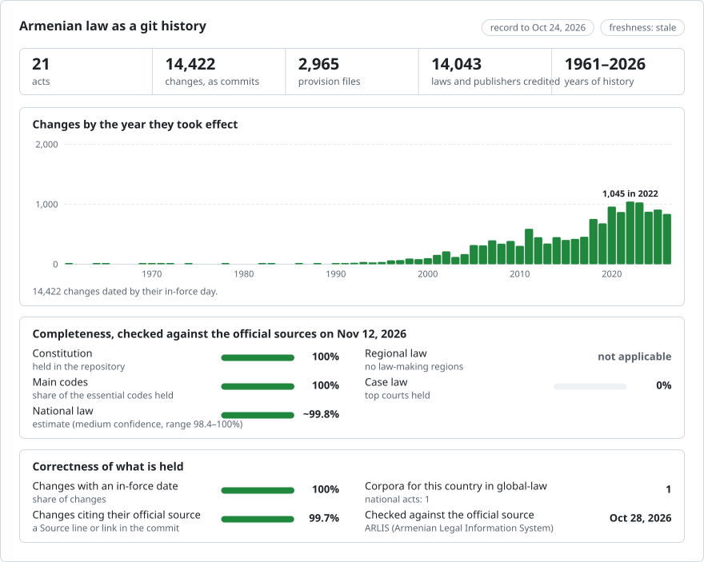

# Armenia: law history in git

**English** · **[Կամ կարդացեք հայերեն](README.md)**

<picture>
<source media="(prefers-color-scheme: dark)" srcset="data/effort-dark.svg">

</picture>

The law of Armenia as a git history: one file per article, one commit per version on the day it took effect, and the act that made each change as the commit's author. `git blame` names the act behind every paragraph; `git log` lists every change to an article; picking a date gives the text in force that day.

Part of [lexifina/global-law](https://github.com/lexifina/global-law), one git history for every country's law: this is Armenia's national law, which global-law reads at `armenia/national/acts/`.

**What is in it now:** 42 codes and 1,337 laws from ARLIS, the official legal information system, and 4 acts ARLIS files as constitutions (the Constitution in its 1995, 2005 and 2015 texts, and the WHO Constitution), with 14,574 versions from 1961 to 2026-10-24. [`laws.csv`](laws.csv) lists every act read from ARLIS, with its link.

Each act is in `<kind>/<year>/<number>/`, by the year it was adopted and its official number (`code/2004/ՀՕ-124-Ն/` is the ՀՀ աշխատանքային օրենսգիրք, the Labour Code, ՀՕ-124-Ն of 9 November 2004); acts without a number use their ARLIS id (`code/1961/id-5`). Each article is a file (`159.md`; article 327¹ is `327.1.md`), one paragraph per line. Until 2026-11-10 each folder was named by its ARLIS id (`code/51` is the Labour Code); `data/paths.json` maps every old name to its folder. `git blame` and `git log --follow` follow a file across that move; `git log` without `--follow` needs the old name for earlier versions; `tools/in_force_on.py` takes either name.

The text is in Armenian, the authoritative original, as ARLIS publishes it. An English translation is not part of this record.

## Questions as git commands

| Question | Command |
| --- | --- |
| Every change to Article 159 of the Labour Code (annual leave) | `git log -p --word-diff --follow -- code/2004/ՀՕ-124-Ն/159.md` |
| Which act wrote each line of Article 159? | `git blame code/2004/ՀՕ-124-Ն/159.md` |
| Every version of the Labour Code, with the day each took effect | `git log --format="%h %(trailers:key=In-force,valueonly,separator=) %an" -- code/2004/ՀՕ-124-Ն code/51` |
| Article 159 as in force on 1 January 2015 | `python tools/in_force_on.py 2015-01-01 code/2004/ՀՕ-124-Ն 159` |

**Outside git**, we also host this record publicly, for free:

- **[Ask Claude about Armenian law](https://global-law.lexifina.com/v1/try_claude?country=armenia)**: opens Claude with a first question ready.
- **[Ask ChatGPT](https://global-law.lexifina.com/v1/try_chatgpt?country=armenia)**: the same question in ChatGPT.
- **[Call the API in your browser](https://global-law.lexifina.com/v1/search_law?query=%D5%A1%D5%B4%D5%A5%D5%B6%D5%A1%D5%B4%D5%B5%D5%A1+%D5%A1%D6%80%D5%B1%D5%A1%D5%AF%D5%B8%D6%82%D6%80%D5%A4&jurisdictions=armenia)**: a search of Armenian law for "ամենամյա արձակուրդ" (annual leave), returned as JSON. See the [documentation here](https://lexifina.com/api/global-law).

Both assistants read the record through the free Global law connector (MCP, `https://global-law.lexifina.com/mcp`); the first time, the chat gives you the link that adds it. Ask in Armenian or in English.

**Host it yourself easily.** All it takes is git and Python, and the tools run on your machine:

```sh
git clone --depth 1 https://github.com/lexifina/global-law && cd global-law
python3 tools/countries.py add armenia/national/acts
python3 tools/law.py show 2026-01-01 armenia/national/acts/code/2004/ՀՕ-124-Ն/159.md
```

Opened in Claude Code, Cursor, VS Code or Codex, the clone also starts a local MCP server with the same tools ([MCP.md](https://github.com/lexifina/global-law/blob/main/MCP.md)).

## Dates

Each commit is dated at noon, Asia/Yerevan, on the day the version took effect, and carries it in its `In-force:` trailer:

- for a consolidated text, the first day of the period of application ARLIS gives it (`Գործում է (01.09.2026-01.11.2026)`); the amending act's adoption day is in `Enacted:`;
- for a law's first commit, its original act (`Kind: original`), the day of entry into force ARLIS gives;
- git cannot store dates before 1970, so the 10 earlier commits (Soviet-era codes and laws) are dated from 1970-01-01, one second apart, with the real day in `In-force:`. Ask for a date with `tools/in_force_on.py`, not `git log --before`;
- texts that apply after the build day (2026-10-28) are on the `future` branch, which is never merged into `main`.

Each change is credited to the amending act ARLIS made that consolidated text for, by its number and adoption day (`ՀՕ-160-Ն (03.05.2023)`); one commit holds everything one act changed on one day. Where the article's own history note names another amending act that has no text of its own, the change goes to the latest such act (`Evidence:` says which rule applied).

## How it is checked

- Before each push, `tools/in_force_on.py` is compared with ARLIS's own text for several articles and dates.
- Two builds from the same retrieved texts give the same commit hashes; the sha256 of every downloaded text is in [`data/texts-sha256.tsv`](data/texts-sha256.tsv) (see [`REPRODUCE.md`](REPRODUCE.md)).
- A text less than half in Armenian letters is not used; the 3 such texts are listed in [`data/unreadable.csv`](data/unreadable.csv).
- History is append-only: no merge commits, no rewriting, no commit dated in the future, and every commit's trailers parse.

## What it does not show

- **Sub-laws** (government and prime-minister decisions, ministerial orders) are not here; they are being built in [lexifina/armenia-sublaws](https://github.com/lexifina/armenia-sublaws).
- **Texts ARLIS never made.** 479 amending acts it lists, to 102 laws, have no consolidated text ([`data/not-incorporated.csv`](data/not-incorporated.csv)); their changes arrive with the next text, so one commit may hold several acts' changes.
- **Laws that only amend others** are commit authors, not files; their transitional provisions are in the act at each commit's `Source:` link.
- **ARLIS's own additions:** its case-law links, tables of contents, and English and Russian translations.

## Sources

| Source | Kind | Past versions | Notes |
| --- | --- | --- | --- |
| [ARLIS](https://www.arlis.am) | Official legal information system of the Republic of Armenia | yes, every consolidated text with its period of application | Texts are marked official or unofficial; the authoritative text is the official publication cited at each commit's `Source:` link |

## Licence

See [`LICENSE`](LICENSE). Under article 4(1)(c) of the Law on Copyright and Related Rights (ՀՕ-142-Ն, 15 June 2006), official documents, legal acts among them, are not objects of copyright; the texts are reproduced without change to their wording. Lexifina's own contributions (tools, arrangement, commit messages and documentation) are CC0 1.0.

No AI model reads, writes, summarises or classifies legal text; the scripts and documentation were written by an AI model (see [`REPRODUCE.md`](REPRODUCE.md)).

## More

From [lexifina/global-law](https://github.com/lexifina/global-law):

- [FEATURES.md](https://github.com/lexifina/global-law/blob/main/FEATURES.md): every feature, and what every corpus must support (`git blame`, `law.py`, the MCP tools)
- [FAQ.md](https://github.com/lexifina/global-law/blob/main/FAQ.md): questions and answers · [CONTRIBUTING.md](https://github.com/lexifina/global-law/blob/main/CONTRIBUTING.md): proposing changes · [MCP.md](https://github.com/lexifina/global-law/blob/main/MCP.md): the MCP server · [REPRODUCE.md](https://github.com/lexifina/global-law/blob/main/REPRODUCE.md): how it was built · [CHANGELOG.md](https://github.com/lexifina/global-law/blob/main/CHANGELOG.md)
- [FRESHNESS.md](https://github.com/lexifina/global-law/blob/main/FRESHNESS.md): how current each corpus is · [Monitoring](https://github.com/lexifina/global-law/tree/main/monitoring): whether updates are running · [WATCHING.md](https://github.com/lexifina/global-law/blob/main/WATCHING.md): how each official source is watched for changes
- [performance/](https://github.com/lexifina/global-law/tree/main/performance): how fast the tools are, measured
- [visualisations/](https://github.com/lexifina/global-law/tree/main/visualisations): charts and bridges across the world's law
- [Vulnerabilities](https://github.com/lexifina/global-law/tree/main/vulnerabilities): mistakes in legislation as published
