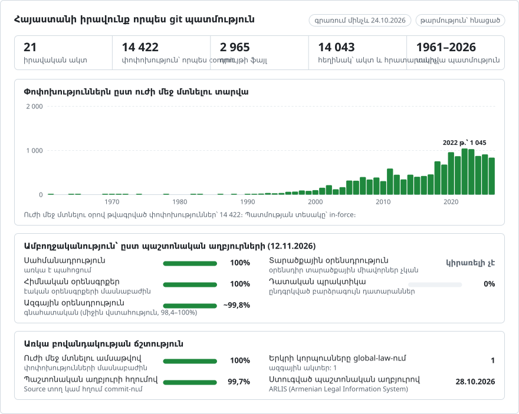

# Հայաստանի իրավունքը՝ փոփոխություն առ փոփոխություն

**Հայերեն** · [English](README.en.md)

<picture>
<source media="(prefers-color-scheme: dark)" srcset="data/hy/effort-dark.svg">

</picture>

Մաս է կազմում [lexifina/global-law](https://github.com/lexifina/global-law) նախագծի, որը բոլոր երկրների իրավունքը պահում է մեկ git պատմության մեջ։ Սա Հայաստանի ազգային իրավունքն է, որը global-law-ն կարդում է `armenia/national/acts/` հասցեում։

Հայաստանի Հանրապետության օրենքները՝ որպես git պահոց. Սահմանադրությունը, 42 օրենսգիրք և 1 342 օրենք [ARLIS](https://www.arlis.am)-ից՝ Հայաստանի Հանրապետության պաշտոնական իրավական տեղեկատվական համակարգից։ Յուրաքանչյուր հոդված առանձին ֆայլ է, յուրաքանչյուր պարբերություն՝ առանձին տող։ Յուրաքանչյուր փոփոխություն commit է, որը վերագրված է այն կատարած ակտին և թվագրված է փոփոխված տեքստի ուժի մեջ մտնելու օրով՝ Երևանի ժամանակով կեսօրին։ Տեքստը հայերեն բնօրինակն է, որը վավերական տեքստն է։

`main`-ում գրառումն ընդգրկում է 1961-03-07-ից մինչև 2026-10-24 ժամանակահատվածը՝ 14 423 commit, որոնք կառուցված են 14 487 տեքստից՝ յուրաքանչյուր օրենքի սկզբնական ակտից և դրա բոլոր համախմբված տեքստերից, որոնք պատրաստել է ARLIS-ը։ Եվս 6 commit կիրառվում է կառուցման օրվանից հետո և գտնվում է `future` ճյուղում։

## Իրավաբանի հարցերը՝ որպես git հրամաններ

| Հարց | Հրաման |
| --- | --- |
| Ի՞նչ էր ասում «Հեղինակային իրավունքի և հարակից իրավունքների մասին» օրենքի 4-րդ հոդվածը 2012 թվականի հունիսի 1-ին | `python tools/in_force_on.py 2012-06-01 law/25161 4` |
| Ամբողջ օրենքը տվյալ ամսաթվին | `python tools/in_force_on.py 2012-06-01 law/25161` |
| Ո՞ր ակտն է վերջինը փոխել հոդվածի յուրաքանչյուր պարբերությունը | `git blame law/25161/4.md` |
| Հոդվածի բոլոր փոփոխությունները՝ դրանք կատարած ակտով | `git log -p law/25161/4.md` |
| Փոխված բառերը, ոչ թե ամբողջ պարբերությունները | `git log -p --word-diff law/25161/4.md` |
| Այն ամենը, ինչ փոխել է մեկ ակտը՝ բոլոր օրենքներում | `git log --author='ՀՕ-106-Ն' --stat` |
| Օրենքը փոխած բոլոր ակտերը՝ ըստ հերթականության | `git log --format='%(trailers:key=In-force,valueonly,separator=) %an' -- law/25161` |
| Ինչ է ուժի մեջ մտնում այսօրվանից հետո | `git log main..future` |
| Օրենքների ցանկը՝ ARLIS-ի հղումներով | [`laws.csv`](laws.csv) |

«Այս ամսաթվին» տիպի հարցերի համար օգտագործեք `tools/in_force_on.py`-ը, ոչ թե `git log --before`-ը։ Այն տեքստն ընտրում է ըստ `In-force:` դաշտի (commit-ի trailer), ուստի ճիշտ արդյունք է տալիս ցանկացած ժամային գոտում և 1970 թվականից առաջ ամսաթվերի համար։ Եթե օգտագործում եք զուտ git, ժամը գրեք ամբողջությամբ՝ `git rev-list -1 --before="2012-06-01T23:59:59+04:00" main`։ PowerShell-ում `git show "$(git rev-list -1 --before=... main):law/25161/4.md"` հրամանում չակերտները պարտադիր են։

Թղթապանակներն են `constitution/`, `code/` և `law/`, իսկ յուրաքանչյուր օրենքի թղթապանակ անվանված է ըստ դրա ARLIS համարի՝ `arlis.am/hy/acts/N` հասցեի `N`-ի։ Դրա ներսում յուրաքանչյուր հոդվածի համար կա մեկ ֆայլ (`4.md`, `22.1.md`. վերին ինդեքսով հոդվածը, օրինակ՝ 327¹-ը, դառնում է `327.1.md`), յուրաքանչյուր հավելվածի համար՝ մեկ ֆայլ (`annex-1.md`), և `title.md`՝ առաջին հոդվածին նախորդող տեքստի համար։ Հոդվածի ֆայլը սկսվում է դրանից վեր գտնվող մասի և գլխի վերնագրերով (`##`), այնուհետև գալիս է վերնագրի տողը (`# Հոդված 4. …`), ապա յուրաքանչյուր պարբերություն՝ առանձին տողով։ Յուրաքանչյուր հոդվածի պատմության սեփական նշումը, օրինակ՝ `(4-րդ հոդվածը լրաց. 30.09.13 ՀՕ-106-Ն)`, պահպանվում է որպես առանձին տող՝ ճիշտ այնպես, ինչպես այն տպում է ARLIS-ը։

## Ամսաթվերը և թե որն ենք օգտագործում

ARLIS-ը պահում է օրենքի բոլոր համախմբված տեքստերը, որոնք պատրաստել է, և յուրաքանչյուրի համար նշում է դրա կիրառման ժամանակահատվածը, օրինակ՝ `Գործում է (01.09.2026-01.11.2026)`։ **Commit-ները թվագրված են այդ ժամանակահատվածի առաջին օրով։** Հենց այդ ամսաթիվն է որոշում, թե որ տեքստն է կիրառվում տվյալ գործի նկատմամբ, և դա այն օրն է, երբ այդ տեքստում կատարված փոփոխություններն ուժի մեջ են մտել։ Փոփոխող ակտի ընդունման ամսաթիվը `Enacted:` դաշտում է։ 2 commit-ում տեքստը կիրառվում է ակտի ընդունումից ավելի վաղ օրվանից (հետադարձ ուժ)։ Այդ commit-ները պահպանում են ուժի մեջ մտնելու ամսաթիվը և ցույց են տալիս ընդունման ամսաթիվը։

Յուրաքանչյուր օրենքի առաջին commit-ը դրա սկզբնական ակտն է (`Kind: original`)՝ թվագրված օրենքի ուժի մեջ մտնելու օրով։ ARLIS-ի համախմբված տեքստերից ավելի հին օրենքների դեպքում որոշ միջանկյալ տեքստեր կարող են բացակայել։ Այդ դեպքում դրանց հաջորդ commit-ը կարող է միանգամից մի քանի փոփոխություն պարունակել (տե՛ս «Ինչ է նշանակում հեղինակը» բաժինը)։

**Git-ը չի կարող պահել 1970 թվականից առաջ ամսաթվեր։** Ավելի վաղ ուժի մեջ մտած օրենքները (խորհրդային շրջանի օրենսգրքերը) commit են արված 1970-01-01 ամսաթվով՝ միմյանցից մեկ վայրկյան տարբերությամբ և հերթականությամբ։ Դրանց իրական ամսաթիվը `In-force:` դաշտում է, որը կարդում է `tools/in_force_on.py`-ը։

**Կառուցման օրվանից հետո կիրառվող տեքստերը** գտնվում են `future` ճյուղում, որը սկսվում է `main`-ի վերջին commit-ից և երբեք չի միաձուլվում դրա մեջ, ուստի `main`-ը երբեք ցույց չի տալիս տեքստ, որը դեռ օրենք չէ։ Վերակառուցումից հետո գործարկեք `git fetch --force origin future`։

## Ինչ է նշանակում հեղինակը (author)

Commit-ի հեղինակը այն ակտն է, որը կատարել է փոփոխությունը, այնպիսի հասցեով, որը չի կարող գոյություն ունենալ, օրինակ՝ `ՀՕ-106-Ն (30.09.2013) <ho-106-n-20130930@arlis.invalid>`։ Համարը ակտի պաշտոնական համարն է (ՀՕ = Հայաստանի Հանրապետության օրենք), իսկ ամսաթիվը՝ դրա ընդունման ամսաթիվը։ Այսպիսով, `git blame`-ը յուրաքանչյուր պարբերության համար նշում է այն ակտը, որը վերջինն է այն գրել։ Մեկ commit-ը պարունակում է այն ամենը, ինչ մեկ ակտը փոխել է մեկ օրում՝ իր փոփոխած բոլոր օրենքներում։

ARLIS-ը յուրաքանչյուր համախմբված տեքստ կապում է այն մեկ փոփոխող ակտի հետ, որի համար այն պատրաստվել է, և փոփոխությունը վերագրվում է այդ ակտին (`Evidence: edition`)։ Եթե փոփոխված հոդվածի պատմության սեփական նշման մեջ նոր է հայտնվում այդ ակտը, ապացույցը `note` է։ Եթե փոխարենը նշման մեջ նոր է հայտնվում նույն օրենքի մեկ այլ փոփոխող ակտ, որը սեփական համախմբված տեքստ չունի, փոփոխությունը վերագրվում է այդպիսի վերջին ակտին (`Evidence: note (no text of its own)`)։ Այն փոփոխող ակտերը, որոնք ARLIS-ը թվարկում է, բայց որոնց համար երբեք տեքստ չի պատրաստել (513), ներկայացված են [`data/not-incorporated.csv`](data/not-incorporated.csv) ֆայլում։ Դրանց փոփոխությունները այս գրառման մեջ են հայտնվում միայն հաջորդ պատրաստված տեքստի միջոցով։

Ապացույցների քանակն ըստ փոփոխված միավորների՝ note՝ 30 098, edition՝ 46 429, սեփական տեքստ չունեցող note՝ 608։ Ընդհանուր առմամբ կա 1 383 սկզբնական ակտ և 13 039 փոփոխության commit՝ 13 027 փոփոխող ակտից։

Blame-ը վերագրում է ամբողջական պարբերություններ։ Երկու ակտով փոխված պարբերության համար նշվում է միայն ավելի ուշ ակտը, ուստի յուրաքանչյուր ակտի բառերը տեսնելու համար օգտագործեք `git log -p --word-diff`։

## Ինչ այն ցույց չի տալիս

- Ենթաօրենսդրական ակտերը՝ կառավարության որոշումները, նախարարների հրամանները և օրենքից ցածր մակարդակի այլ ակտեր։ Դրանք ներառված չեն այս կառուցման մեջ։
- Տեքստերը, որոնք ARLIS-ը չի համախմբել (տե՛ս վերևում), և տեքստերը, որոնք ARLIS-ը չկարողացավ տրամադրել կամ մենք չկարողացանք կարդալ (3, [`data/unreadable.csv`](data/unreadable.csv) ֆայլում)։
- Օրենքները, որոնց միակ նպատակն այլ օրենքներ փոփոխելն է։ Այստեղ դրանք commit-ների հեղինակներ են, ոչ թե ֆայլեր։ Դրանց սեփական անցումային դրույթները, որոնք սահմանում են, թե երբ և որ դեպքերի նկատմամբ է կիրառվում փոփոխությունը, առկա են յուրաքանչյուր ակտում՝ commit-ի `Source:` հղումով։
- ARLIS-ի հղումները դատական պրակտիկային, դրա բովանդակության ցանկերը և անգլերեն ու ռուսերեն թարգմանությունները։
- Վերահամարակալումը. նոր համար ստացած հոդվածը երևում է որպես մեկ ֆայլի հեռացում և մեկ այլ ֆայլի ավելացում։

ARLIS-ի համախմբված տեքստերը նշված են որպես պաշտոնական կամ ոչ պաշտոնական։ Այս պահոցը հետազոտական օժանդակ միջոց է և պաշտոնական հրապարակում չէ։ Վավերական տեքստի համար տե՛ս `Source:` հղումով նշված պաշտոնական հրապարակումը։

## Ինչպես է այն ստուգվում

- Յուրաքանչյուր push-ից առաջ `tools/in_force_on.py`-ի արդյունքը համեմատվում է ARLIS-ի սեփական տեքստի հետ մի քանի հոդվածի և ամսաթվի համար։
- Յուրաքանչյուր commit-ի դաշտերը (trailers) ճիշտ են վերլուծվում `git interpret-trailers --parse`-ով։
- `main`-ում միաձուլման (merge) commit-ներ չկան, դրա commit-ների ամսաթվերը երբեք հետ չեն գնում, և դրանցից ոչ մեկը կառուցման օրվանից հետո չէ։
- Նույն ստացված տեքստերից երկու կառուցում տալիս են նույն commit hash-երը։

Յուրաքանչյուր ներբեռնված տեքստի sha256-ը [`data/texts-sha256.tsv`](data/texts-sha256.tsv) ֆայլում է։ Տե՛ս [`REPRODUCE.md`](REPRODUCE.md)։

## Ինչպես է այն կառուցված

Գրառումը պարունակում է ARLIS-ի որոնման միջոցով գտնված բոլոր սահմանադրությունները, օրենսգրքերը և օրենքները՝ բացառությամբ այն ակտերի, որոնք միայն այլ ակտեր են փոփոխում։ Յուրաքանչյուր օրենքի համար օգտագործվում է օրենքի փոփոխությունների պատմությունը, որը փոփոխող ակտերը կապում է համախմբված տեքստերի հետ, ինչպես նաև սկզբնական ակտի և յուրաքանչյուր համախմբված տեքստի տպելու տարբերակը։ `parse_text.py`-ը յուրաքանչյուր տեքստ բաժանում է հոդվածների և պարբերությունների։ `build.py`-ը համեմատում է յուրաքանչյուր օրենքի տեքստերը՝ ըստ ամսաթվերի հերթականության, և յուրաքանչյուր փոփոխություն վերագրում է վերը նկարագրված կերպով։ Այն գրում է ամբողջ պատմությունը մեկ `git fast-import`-ով։ Ոչ մի AI մոդել չի կարդում կամ գրում որևէ տեքստ՝ ո՛չ կառուցման, ո՛չ էլ ստուգումների ժամանակ։

## Լիցենզիա

Աղբյուրը՝ ARLIS, Հայաստանի Հանրապետության իրավական տեղեկատվական համակարգ (www.arlis.am)։ «Հեղինակային իրավունքի և հարակից իրավունքների մասին» Հայաստանի Հանրապետության օրենքի (ՀՕ-142-Ն, 2006) 4-րդ հոդվածի 1-ին մասի «գ» կետի համաձայն՝ պաշտոնական փաստաթղթերը, այդ թվում՝ իրավական ակտերը և դրանց պաշտոնական թարգմանությունները, հեղինակային իրավունքի օբյեկտ չեն։ Այստեղ տեքստերը բաժանվել են ֆայլերի և դասավորվել որպես commit-ներ. դրանց ձևակերպումը չի փոխվել։ Lexifina-ի սեփական ներդրումները (գործիքները, դասավորությունը և commit-ների հաղորդագրությունները) տրամադրվում են CC0 պայմաններով։ Տե՛ս [`LICENSE`](LICENSE)։

Սա անգլերեն տարբերակի ([README.en.md](README.en.md)) թարգմանությունն է։ Եթե դրանք տարբերվում են, գերակայում է անգլերեն տարբերակը։

## Ավելին

[lexifina/global-law](https://github.com/lexifina/global-law) պահոցից (անգլերեն)՝

- [FEATURES.md](https://github.com/lexifina/global-law/blob/main/FEATURES.md): բոլոր հնարավորությունները և այն, ինչ պետք է աջակցի յուրաքանչյուր կորպուս (`git blame`, `law.py`, MCP գործիքներ)
- [FAQ.md](https://github.com/lexifina/global-law/blob/main/FAQ.md): հարցեր և պատասխաններ · [CONTRIBUTING.md](https://github.com/lexifina/global-law/blob/main/CONTRIBUTING.md): ինչպես առաջարկել փոփոխություններ · [MCP.md](https://github.com/lexifina/global-law/blob/main/MCP.md): MCP սերվեր · [REPRODUCE.md](https://github.com/lexifina/global-law/blob/main/REPRODUCE.md): ինչպես է այն կառուցված · [CHANGELOG.md](https://github.com/lexifina/global-law/blob/main/CHANGELOG.md)
- [FRESHNESS.md](https://github.com/lexifina/global-law/blob/main/FRESHNESS.md): որքան արդիական է յուրաքանչյուր կորպուս · [Մոնիտորինգ](https://github.com/lexifina/global-law/tree/main/monitoring): արդյոք թարմացումներն աշխատում են · [WATCHING.md](https://github.com/lexifina/global-law/blob/main/WATCHING.md): ինչպես է յուրաքանչյուր պաշտոնական աղբյուր հետևվում փոփոխությունների համար
- [performance/](https://github.com/lexifina/global-law/tree/main/performance): որքան արագ են գործիքները, չափված
- [visualisations/](https://github.com/lexifina/global-law/tree/main/visualisations): գծապատկերներ և կապեր ամբողջ աշխարհի իրավունքում
- [Խոցելիություններ](https://github.com/lexifina/global-law/tree/main/vulnerabilities): սխալներ ակտերում՝ այնպես, ինչպես դրանք հրապարակվել են
