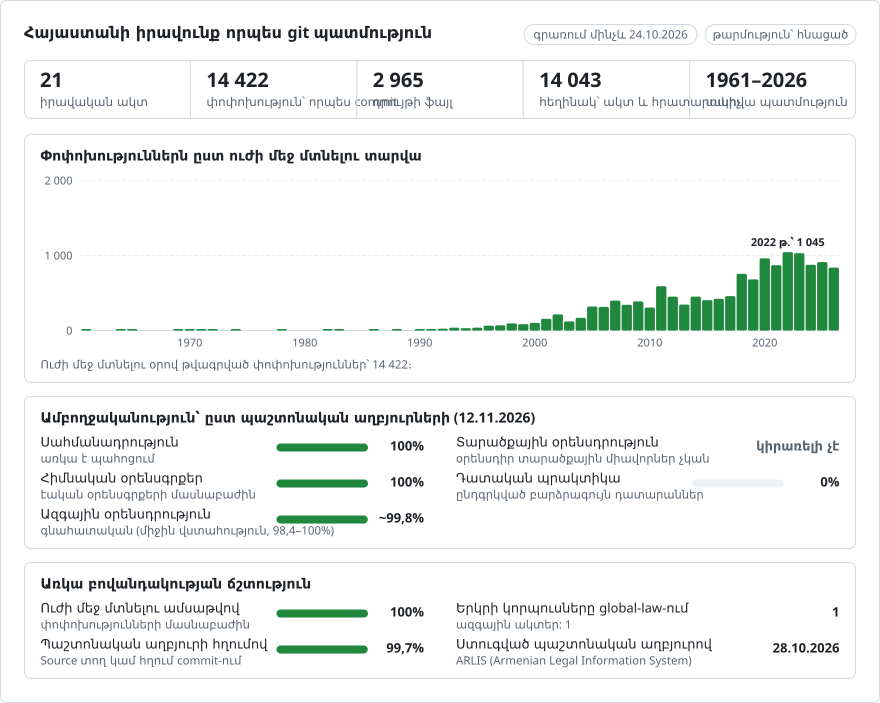

# Հայաստան. իրավունքի պատմությունը git-ում

**Հայերեն** · **[Or read it in English](README.en.md)**

<picture>
<source media="(prefers-color-scheme: dark)" srcset="data/hy/effort-dark.svg">

</picture>

Հայաստանի իրավունքը՝ որպես git պատմություն. մեկ ֆայլ՝ յուրաքանչյուր հոդվածի համար, մեկ commit՝ յուրաքանչյուր տարբերակի համար՝ դրա ուժի մեջ մտնելու օրը, իսկ commit-ի հեղինակն այն ակտն է, որը կատարել է փոփոխությունը։ `git blame`-ը նշում է յուրաքանչյուր պարբերության հետևում կանգնած ակտը, `git log`-ը թվարկում է հոդվածի բոլոր փոփոխությունները, իսկ ամսաթիվ ընտրելով՝ ստանում եք այդ օրը գործող տեքստը։

Մաս է կազմում [lexifina/global-law](https://github.com/lexifina/global-law) նախագծի՝ բոլոր երկրների իրավունքի մեկ git պատմության. սա Հայաստանի ազգային իրավունքն է, որը global-law-ն կարդում է `armenia/national/acts/` հասցեում։

**Ինչ է պարունակում հիմա.** 42 օրենսգիրք և 1 337 օրենք ARLIS-ից՝ պաշտոնական իրավական տեղեկատվական համակարգից, և 4 ակտ, որոնք ARLIS-ը դասում է սահմանադրությունների շարքում (Սահմանադրությունը՝ իր 1995, 2005 և 2015 թվականների տեքստերով, և Առողջապահության համաշխարհային կազմակերպության սահմանադրությունը)՝ 14 574 տարբերակով՝ 1961 թվականից մինչև 2026-10-24։ [`laws.csv`](laws.csv)-ը թվարկում է ARLIS-ից կարդացված բոլոր ակտերը՝ իրենց հղումներով։

Յուրաքանչյուր ակտ գտնվում է `<kind>/<year>/<number>/` թղթապանակում՝ ըստ ընդունման տարվա և պաշտոնական համարի (`code/2004/ՀՕ-124-Ն/`-ը ՀՀ աշխատանքային օրենսգիրքն է՝ ՀՕ-124-Ն, 2004 թվականի նոյեմբերի 9-ի). համար չունեցող ակտերը կրում են իրենց ARLIS id-ն (`code/1961/id-5`)։ Յուրաքանչյուր հոդված առանձին ֆայլ է (`159.md`. 327¹ հոդվածը `327.1.md`-ն է), յուրաքանչյուր պարբերություն՝ առանձին տող։ Մինչև 2026-11-10-ը յուրաքանչյուր թղթապանակ անվանված էր իր ARLIS id-ով (`code/51`-ը աշխատանքային օրենսգիրքն է). `data/paths.json`-ը յուրաքանչյուր հին անվանում կապում է իր թղթապանակի հետ։ `git blame`-ը և `git log --follow`-ը ֆայլին հետևում են նաև այդ տեղափոխությունից առաջ. `git log`-ը առանց `--follow`-ի և `tools/in_force_on.py`-ը ավելի վաղ տարբերակների համար պահանջում են հին անվանումը։

Տեքստը հայերեն է՝ վավերական բնօրինակը, այնպես, ինչպես այն հրապարակում է ARLIS-ը։ Անգլերեն թարգմանությունն այս գրառման մաս չէ։

## Հարցերը՝ որպես git հրամաններ

| Հարց | Հրաման |
| --- | --- |
| Աշխատանքային օրենսգրքի 159-րդ հոդվածի (ամենամյա արձակուրդ) բոլոր փոփոխությունները | `git log -p --word-diff --follow -- code/2004/ՀՕ-124-Ն/159.md` |
| Ո՞ր ակտն է գրել 159-րդ հոդվածի յուրաքանչյուր տողը | `git blame code/2004/ՀՕ-124-Ն/159.md` |
| Աշխատանքային օրենսգրքի բոլոր տարբերակները՝ յուրաքանչյուրի ուժի մեջ մտնելու օրով | `git log --format="%h %(trailers:key=In-force,valueonly,separator=) %an" -- code/2004/ՀՕ-124-Ն code/51` |
| 159-րդ հոդվածը՝ 2015 թվականի հունվարի 1-ին գործող խմբագրությամբ | `python tools/in_force_on.py 2015-01-01 code/51 159` |

**Git-ից դուրս** այս գրառումը նաև հրապարակում ենք հանրայնորեն և անվճար.

- **[Հարցրեք Claude-ին Հայաստանի իրավունքի մասին](https://global-law.lexifina.com/v1/try_claude?country=armenia)**: բացում է Claude-ը՝ պատրաստի առաջին հարցով։
- **[Հարցրեք ChatGPT-ին](https://global-law.lexifina.com/v1/try_chatgpt?country=armenia)**: նույն հարցը ChatGPT-ում։
- **[Կանչեք API-ն ձեր դիտարկիչում](https://global-law.lexifina.com/v1/search_law?query=%D5%A1%D5%B4%D5%A5%D5%B6%D5%A1%D5%B4%D5%B5%D5%A1+%D5%A1%D6%80%D5%B1%D5%A1%D5%AF%D5%B8%D6%82%D6%80%D5%A4&jurisdictions=armenia)**: «ամենամյա արձակուրդ» բառերի որոնում Հայաստանի իրավունքում, պատասխանը՝ JSON ձևաչափով։ Փաստաթղթերը [այստեղ են](https://lexifina.com/api/global-law)։

Երկու օգնականներն էլ գրառումը կարդում են անվճար Global law կոնեկտորի միջոցով (MCP, `https://global-law.lexifina.com/mcp`). առաջին անգամ զրույցը ձեզ կտա այն ավելացնելու հղումը։ Հարցրեք հայերեն կամ անգլերեն։

**Հեշտությամբ գործարկեք այն ինքներդ։** Բավական են git-ը և Python-ը, իսկ գործիքներն աշխատում են ձեր համակարգչում.

```sh
git clone --depth 1 https://github.com/lexifina/global-law && cd global-law
python3 tools/countries.py add armenia/national/acts
python3 tools/law.py show 2026-01-01 armenia/national/acts/code/2004/ՀՕ-124-Ն/159.md
```

Claude Code-ում, Cursor-ում, VS Code-ում կամ Codex-ում բացված կլոնը գործարկում է նաև տեղային MCP սերվեր՝ նույն գործիքներով ([MCP.md](https://github.com/lexifina/global-law/blob/main/MCP.md))։

## Ամսաթվեր

Յուրաքանչյուր commit թվագրված է կեսօրով՝ Երևանի ժամանակով (Asia/Yerevan), այն օրով, երբ տարբերակն ուժի մեջ է մտել, և այդ օրը նշված է նաև դրա `In-force:` դաշտում (trailer).

- համախմբված տեքստի համար՝ կիրառման ժամանակահատվածի առաջին օրը, որը նշում է ARLIS-ը (`Գործում է (01.09.2026-01.11.2026)`). փոփոխող ակտի ընդունման օրը `Enacted:` դաշտում է.
- օրենքի առաջին commit-ի՝ դրա սկզբնական ակտի (`Kind: original`) համար՝ ARLIS-ի նշած ուժի մեջ մտնելու օրը.
- git-ը չի կարող պահել 1970 թվականից առաջ ամսաթվեր, ուստի ավելի վաղ 10 commit-ները (խորհրդային շրջանի օրենսգրքեր և օրենքներ) թվագրված են 1970-01-01-ից սկսած՝ միմյանցից մեկ վայրկյան տարբերությամբ, իսկ իրական օրը `In-force:` դաշտում է։ Ամսաթվով հարցերի համար օգտագործեք `tools/in_force_on.py`-ը, ոչ թե `git log --before`-ը.
- կառուցման օրվանից (2026-10-28) հետո կիրառվող տեքստերը գտնվում են `future` ճյուղում, որը երբեք չի միաձուլվում `main`-ի մեջ։

Յուրաքանչյուր փոփոխություն վերագրվում է այն փոփոխող ակտին, որի համար ARLIS-ը պատրաստել է տվյալ համախմբված տեքստը՝ դրա համարով և ընդունման օրով (`ՀՕ-160-Ն (03.05.2023)`). մեկ commit-ը պարունակում է այն ամենը, ինչ մեկ ակտը փոխել է մեկ օրում։ Եթե հոդվածի պատմության սեփական նշումը նշում է մեկ այլ փոփոխող ակտ, որը սեփական տեքստ չունի, փոփոխությունը վերագրվում է այդպիսի վերջին ակտին (`Evidence:` դաշտը ցույց է տալիս, թե որ կանոնն է կիրառվել)։

## Ինչպես է այն ստուգվում

- Յուրաքանչյուր push-ից առաջ `tools/in_force_on.py`-ի արդյունքը համեմատվում է ARLIS-ի սեփական տեքստի հետ մի քանի հոդվածի և ամսաթվի համար։
- Նույն ստացված տեքստերից երկու կառուցում տալիս են նույն commit hash-երը. յուրաքանչյուր ներբեռնված տեքստի sha256-ը [`data/texts-sha256.tsv`](data/texts-sha256.tsv) ֆայլում է (տե՛ս [`REPRODUCE.md`](REPRODUCE.md))։
- Տեքստը, որի տառերի կեսից պակասն է հայերեն, չի օգտագործվում. այդպիսի 3 տեքստը թվարկված է [`data/unreadable.csv`](data/unreadable.csv) ֆայլում։
- Պատմությունը միայն լրացվում է. չկան միաձուլման (merge) commit-ներ, պատմությունը չի վերագրվում, չկա ապագա ամսաթվով commit, և յուրաքանչյուր commit-ի դաշտերը (trailers) ճիշտ ձևաչափ ունեն։

## Ինչ այն ցույց չի տալիս

- **Ենթաօրենսդրական ակտերը** (կառավարության և վարչապետի որոշումները, նախարարների հրամանները) այստեղ չեն. դրանք կառուցվում են [lexifina/armenia-sublaws](https://github.com/lexifina/armenia-sublaws) պահոցում։
- **Տեքստերը, որոնք ARLIS-ը երբեք չի պատրաստել։** Նրա թվարկած 479 փոփոխող ակտ՝ 102 օրենքի, համախմբված տեքստ չունի ([`data/not-incorporated.csv`](data/not-incorporated.csv)). դրանց փոփոխությունները հայտնվում են հաջորդ տեքստի հետ, ուստի մեկ commit-ը կարող է պարունակել մի քանի ակտի փոփոխություններ։
- **Միայն այլ օրենքներ փոփոխող օրենքները** commit-ների հեղինակներ են, ոչ թե ֆայլեր. դրանց անցումային դրույթները գտնվում են ակտում՝ յուրաքանչյուր commit-ի `Source:` հղումով։
- **ARLIS-ի սեփական հավելումները**՝ դատական պրակտիկայի հղումները, բովանդակության ցանկերը, անգլերեն և ռուսերեն թարգմանությունները։

## Աղբյուրներ

| Աղբյուր | Տեսակ | Նախկին տարբերակներ | Նշումներ |
| --- | --- | --- | --- |
| [ARLIS](https://www.arlis.am) | Հայաստանի Հանրապետության պաշտոնական իրավական տեղեկատվական համակարգ | այո, յուրաքանչյուր համախմբված տեքստ՝ իր կիրառման ժամանակահատվածով | Տեքստերը նշված են որպես պաշտոնական կամ ոչ պաշտոնական. վավերական տեքստը յուրաքանչյուր commit-ի `Source:` հղումով նշված պաշտոնական հրապարակումն է |

## Լիցենզիա

Տե՛ս [`LICENSE`](LICENSE)։ «Հեղինակային իրավունքի և հարակից իրավունքների մասին» օրենքի (ՀՕ-142-Ն, 2006 թվականի հունիսի 15) 4-րդ հոդվածի 1-ին մասի «գ» կետի համաձայն՝ պաշտոնական փաստաթղթերը, այդ թվում՝ իրավական ակտերը, հեղինակային իրավունքի օբյեկտ չեն. տեքստերը վերարտադրված են առանց դրանց ձևակերպումը փոխելու։ Lexifina-ի սեփական ներդրումները (գործիքները, դասավորությունը, commit-ների հաղորդագրությունները և փաստաթղթերը) տրամադրվում են CC0 1.0 պայմաններով։

Ոչ մի AI մոդել չի կարդում, գրում, ամփոփում կամ դասակարգում իրավական տեքստ. սկրիպտները և փաստաթղթերը գրել է AI մոդելը (տե՛ս [`REPRODUCE.md`](REPRODUCE.md))։

Սա անգլերեն տարբերակի ([README.en.md](README.en.md)) թարգմանությունն է։ Եթե դրանք տարբերվում են, գերակայում է անգլերեն տարբերակը։

## Ավելին

[lexifina/global-law](https://github.com/lexifina/global-law) պահոցից (անգլերեն)՝

- [FEATURES.md](https://github.com/lexifina/global-law/blob/main/FEATURES.md): բոլոր հնարավորությունները և այն, ինչ պետք է աջակցի յուրաքանչյուր կորպուս (`git blame`, `law.py`, MCP գործիքներ)
- [FAQ.md](https://github.com/lexifina/global-law/blob/main/FAQ.md): հարցեր և պատասխաններ · [CONTRIBUTING.md](https://github.com/lexifina/global-law/blob/main/CONTRIBUTING.md): ինչպես առաջարկել փոփոխություններ · [MCP.md](https://github.com/lexifina/global-law/blob/main/MCP.md): MCP սերվեր · [REPRODUCE.md](https://github.com/lexifina/global-law/blob/main/REPRODUCE.md): ինչպես է այն կառուցված · [CHANGELOG.md](https://github.com/lexifina/global-law/blob/main/CHANGELOG.md)
- [FRESHNESS.md](https://github.com/lexifina/global-law/blob/main/FRESHNESS.md): որքան արդիական է յուրաքանչյուր կորպուս · [Մոնիտորինգ](https://github.com/lexifina/global-law/tree/main/monitoring): արդյոք թարմացումներն աշխատում են · [WATCHING.md](https://github.com/lexifina/global-law/blob/main/WATCHING.md): ինչպես է յուրաքանչյուր պաշտոնական աղբյուր հետևվում փոփոխությունների համար
- [performance/](https://github.com/lexifina/global-law/tree/main/performance): որքան արագ են գործիքները, չափված
- [visualisations/](https://github.com/lexifina/global-law/tree/main/visualisations): գծապատկերներ և կապեր ամբողջ աշխարհի իրավունքում
- [Խոցելիություններ](https://github.com/lexifina/global-law/tree/main/vulnerabilities): սխալներ ակտերում՝ այնպես, ինչպես դրանք հրապարակվել են
